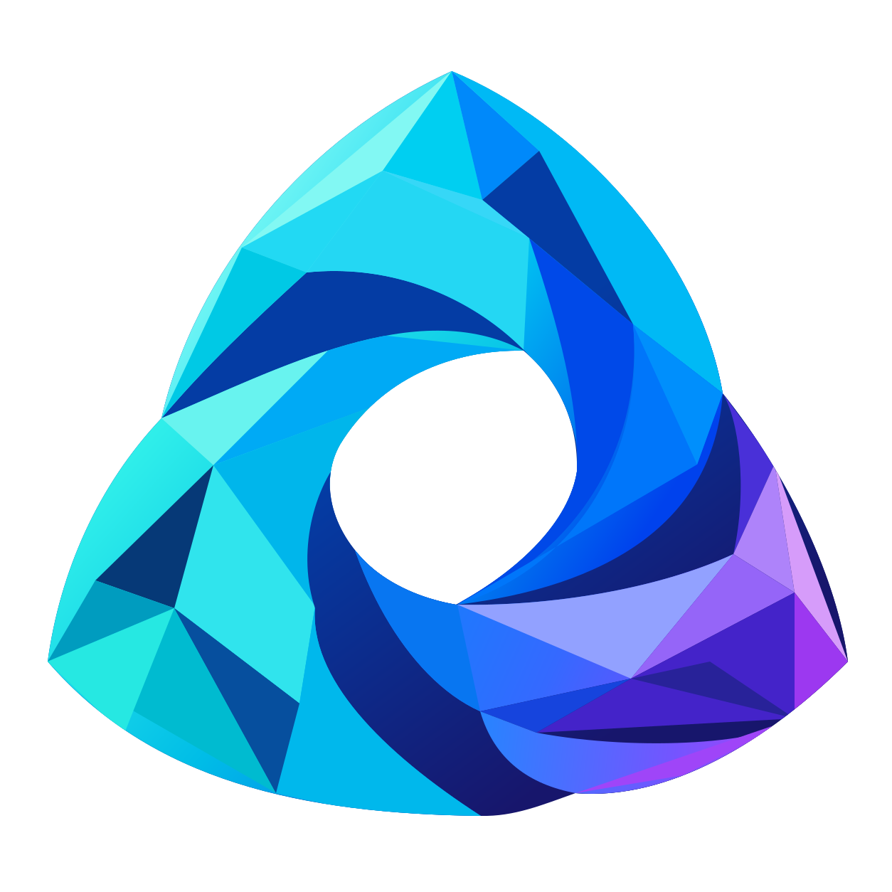

<p align="center">
  
</p>

<h1 align="center">Orchestrate Everything with Agents</h1>

<p align="center">Your agents. Your tools. Your orchestration.</p>
<p align="center">English · <a href="README.zh-CN.md">简体中文</a></p>

Orchestrate Everything with Agents is a lightweight multi-agent development and collaboration platform for individuals. Develop and orchestrate anything within the framework: your own Agents, tools, code, models and workflows, brought together in a workspace on your computer. Start with a conversation, turn repeatable work into a graph, and keep each Agent's context independent while they work toward a shared goal. Of course, if you feel like it, you can let your ChatGPT control it all.

## What you can build

- **Personal Agent workspaces.** Organize Agents, conversations, instructions and skills by project.
- **Your own execution logic.** Edit [Agent architectures](docs/agent-architectures.md) from ReAct, Plan-and-Execute or Reflexion templates, or register a Python graph or protocol-3 process Agent. LangGraph drives Agent and business execution.
- **Independent parallel instances.** Reuse configurations with separate contexts, stable work directories, ordered results and cancellation along actual ownership.
- **Reusable workflows.** Compose Agent, map, condition, template, function, subgraph, wait and end nodes, including loops and parallel joins. Every workflow belongs to one project.
- **Tools and work artifacts.** Register MCP services, grant selected tools, exchange complete collaboration messages and keep session files with source attribution and downloadable references.
- **Practical work tools.** Grant file edits, images, artifacts and explicitly authorized local commands through one [workbench](docs/workbench.md), with optional external language environments.
- **Durable local execution.** Keep task receipts, checkpoints, run history and backups outside the source tree, with explicit cancellation and uncertain-outcome handling.
- **MCP control.** Connect a compatible client through two compact tools and a focused Codex skill. The browser remains available for configuration and observation.

The frontend is served directly from local assets, with no build step. Saved Agent settings, group messages, durable receipts, complete results and artifacts share the same services as the SDK. An optional manager has an independent model and credentials; all roles use the same capability types.

## Run locally

Use Python 3.12+ and a prebuilt wheel matching Windows x64 or Linux x64. Normal installation needs no Rust compiler. Replace the placeholder below with the release wheel's full filename:

MSVC-built Windows wheels also need the [Microsoft Visual C++ v14 x64 runtime](docs/getting-started.md#windows-runtime).

```sh
python -m pip install "./PLATFORM_WHEEL.whl[web,mcp,workbench]"
oea serve --allow-commands
```

Open the printed browser URL; the first-launch default is **http://127.0.0.1:8890**. Keep state on local disk outside source and synchronized folders. The Windows installer also accepts `-Wheel` to prepare a managed environment and launchers. See [installation](docs/getting-started.md) for system prerequisites and source development.

Configure project directory/network defaults, then an Agent's model, credentials and capabilities. Start with one capable Agent and add independent instances when the work needs separate context or responsibility. Managers are optional; main and summary models can be configured independently.

Local tools default to the [native sandbox](docs/native/README.md): PSEC on Windows and Bubblewrap on Linux. Unavailable capabilities fail explicitly. Commands and process Agents also require the host's `--allow-commands` grant. Explicit `trusted` mode provides no OS isolation. Startup creates no demonstration work or model calls.

## Orchestrate with Python

Install the [SDK in your application's Python environment](docs/getting-started.md#sdk-installation) before running Python examples.

```python
from oea import PlatformClient, WorkflowBuilder

graph = (
    WorkflowBuilder()
    .node("start", "start")
    .node("format", "template", value={"text": "Hello, {{inputs.name}}."})
    .node("end", "end", outputs={"text": "{{nodes.format.text}}"})
    .connect("start", "format")
    .connect("format", "end")
    .build()
)

async def run(data_dir, project_id):
    async with PlatformClient.from_data_dir(data_dir) as client:
        workflow = await client.call("workflows.create", {
            "project_id": project_id, "name": "Hello workflow",
            "graph": graph.model_dump(mode="json")})
        receipt = await client.call("workflows.run", {
            "workflow_id": workflow["id"], "inputs": {"name": "world"},
            "idempotency_key": "hello-run-001", "project_id": project_id})
        return await client.call("workflows.result", {
            "workflow_run_id": receipt["id"], "project_id": project_id,
            "timeout": 10})
```

Use an existing project's ID and the host's external data directory. Keep a key when recovering the same request; choose a new run key for a new intended execution. The executable [workflow example](examples/workflow.py) and [Agent examples](examples/model_agent.py) cover the next steps.

## Let a client operate the workspace

```sh
oea mcp
```

The stdio bridge connects to the running host and exposes `platform_guide` and `platform_call`. Use one stable conversation consumer ID. The supplied [Codex skill](integrations/codex/orchestrate-everything-with-agents/SKILL.md) routes discovery, configuration, execution and receipt reading. See [MCP and skills](docs/mcp.md).

## Documentation

Read the **[User Guide](docs/user-guide.md)** for concepts, a first task, browser operations, tools, collaboration, workflows and troubleshooting. Also available in **[简体中文](docs/user-guide.zh-CN.md)**.

[Documentation index](docs/README.md) · [Getting started](docs/getting-started.md) · [SDK](docs/sdk.md) · [Workflows](docs/workflows.md) · [MCP and skills](docs/mcp.md) · [API](docs/api.md) · [Architecture](docs/architecture.md) · [Module interfaces](docs/modules.md) · [Brand](docs/brand.md)

Runtime state belongs on a local disk outside Git repositories and synchronized folders. Connect to an existing host with `PlatformClient`; one Host owns each state directory. Native commands and process Agents use the configured sandbox; explicit trusted execution and in-process function tools run with host authority. Context, action receipts and native graph checkpoints retain their own data ownership during recovery.

## Contributing and license

See [CONTRIBUTING.md](CONTRIBUTING.md) for setup and checks, and [SECURITY.md](SECURITY.md) for sensitive reports. The repository includes generic automated contract tests and source fixtures, with no populated workspace or generated test output.

Licensed under [MIT](LICENSE). OEA 3.2.1 uses the `oea` package and CLI with protocol 3.0. Upgrade existing state through an explicit offline migration into a new directory.
