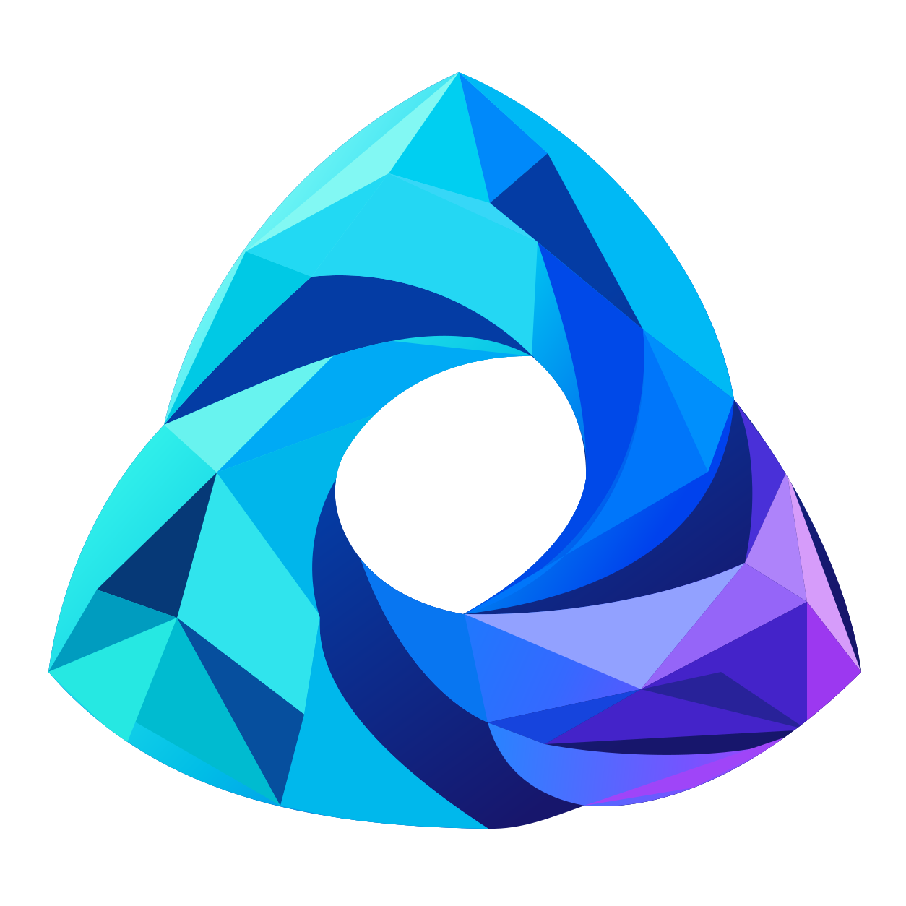

<p align="center">
  
</p>

<h1 align="center">Orchestrate Everything with Agents</h1>

<p align="center">你的 Agent，你的工具，由你编排。</p>
<p align="center"><a href="README.md">English</a> · 简体中文</p>

Orchestrate Everything with Agents 是一个轻量化、面向个人的多智能体开发和协作平台。你可以在我们的框架内开发和编排任何东西：自己的 Agent、工具、代码、模型与工作流，都能汇聚到本机的同一个工作空间。从一段对话开始，把重复工作连接成图，让各个 Agent 保持独立上下文，朝着共同目标协作。当然，如果你乐意的话，你可以让你的ChatGPT操控这一切。

可通过 [Agent 架构](docs/agent-architectures.md) 从 ReAct、Plan-and-Execute、Reflexion 模板编辑执行结构，按草稿、候选与生效版本管理。源码、SDK、MCP 和桌面设置页复用同一执行与恢复契约。

## 可以用它做什么

- **搭建个人 Agent 工作空间。** 按项目管理 Agent、会话、指令和技能。
- **开发自己的执行逻辑。** 配置模型 Agent，编写 协议 3 Python 进程 Agent，或注册由 LangGraph 驱动的代码图。
- **并行启动独立实例。** 复用 Agent 配置，按输入批量创建独立上下文；保留有序结果，并沿实际工作归属取消。
- **编排可复用的工作流。** 在画布或 Python SDK 中连接开始、Agent、并行 map、条件、模板、函数、子图、中断和结束节点；每个工作流只属于一个项目。
- **工具和工作产物。** 注册 MCP 服务，按需授权工具，交换完整协作消息；会话文件保留来源记录，并可通过引用下载。
- **分配实际工作能力。** 通过统一[工作底座](docs/workbench.md)授权命令会话、补丁、图片与产物，复用原生隔离环境和外部语言工具链。
- **在本机持久运行。** 任务回执、检查点、运行历史与备份保存在源码目录之外，明确处理取消和结果不确定的情况。
- **通过 MCP 操作平台。** 用两个紧凑工具和按需加载的 Codex 技能接入兼容客户端，浏览器负责配置与观察。

前端直接使用本地静态资源，无需构建。任务与依赖、协作消息、工作产物集中在会话总览顶部标签页，新活动以红点提醒。工作流画布支持校验、版本检查、导入导出、删除与回收站恢复。

## 本机启动

OEA 需要 Python 3.12+。安装与 Windows x64 或 Linux x64 匹配的预编译 wheel，普通安装无需 Rust 编译器。把下方占位文件名替换为发布包中的完整文件名：

MSVC 构建的 Windows wheel 还需要 [Microsoft Visual C++ v14 x64 运行库](docs/getting-started.md#windows-runtime)。请先安装或修复微软官方运行库；OEA 安装器不代为安装此系统依赖。

```sh
python -m pip install "./PLATFORM_WHEEL.whl[web,mcp,workbench]"
oea serve --allow-commands
```

在另一个终端运行 `oea open` 打开已授权的工作台。首次默认地址是 **http://127.0.0.1:8890**，直接访问首页不会获得管理权限。状态保存在本机源码和同步目录之外。Windows 也可用安装器的 `-Wheel` 参数准备托管环境和启动脚本；源码开发及系统依赖见[安装指南](docs/getting-started.md)。

创建项目，配置默认目录与网络策略，再保存 Agent 的模型、密钥和能力。先让一个 Agent 完成工作，需要独立上下文或职责时再增加实例。manager 是可选角色；主模型和摘要可独立配置。

本地工具默认使用[原生沙箱](docs/native/README.md)，Windows 为 PSEC，Linux 为 Bubblewrap；不可用时明确报错。命令和进程 Agent 还需要宿主的 `--allow-commands` 授权。显式 `trusted` 模式没有 OS 隔离。启动不会创建演示工作或调用模型。

## 用 Python 编排

运行 Python 示例前，先在应用使用的 Python 环境中[安装 SDK](docs/getting-started.md#sdk-installation)。

```python
from oea import PlatformClient, WorkflowBuilder

graph = (
    WorkflowBuilder()
    .node("start", "start")
    .node("format", "template", value={"text": "你好，{{inputs.name}}。"})
    .node("end", "end", outputs={"text": "{{nodes.format.text}}"})
    .connect("start", "format")
    .connect("format", "end")
    .build()
)

async def run(data_dir, project_id):
    async with PlatformClient.from_data_dir(data_dir) as client:
        workflow = await client.call("workflows.create", {
            "project_id": project_id, "name": "你好工作流",
            "graph": graph.model_dump(mode="json")})
        receipt = await client.call("workflows.run", {
            "workflow_id": workflow["id"], "inputs": {"name": "世界"},
            "idempotency_key": "hello-run-001", "project_id": project_id})
        return await client.call("workflows.result", {
            "workflow_run_id": receipt["id"], "project_id": project_id, "timeout": 10})
```

传入已有项目 ID 和宿主使用的外部数据目录。恢复同一次请求时沿用原幂等键；真正开始下一次运行时使用新键。可直接执行的[工作流示例](examples/workflow.py)和 [Agent 示例](examples/model_agent.py)提供后续参考。

## 让客户端操作这一切

```sh
oea mcp
```

桥接进程连接已有宿主，提供 `platform_guide` 与 `platform_call`。从前端复制生成的配置，再安装仓库提供的 [Codex 技能](integrations/codex/orchestrate-everything-with-agents/SKILL.md)。安装、按需发现接口和权限说明见 [MCP 与技能指南](docs/mcp.md)。连接 ChatGPT 时，所用客户端环境需能够访问选定的 MCP 传输。

## 文档

外部应用后端可通过 [OAP 1.0](docs/applications/README.md) 调用获准 Agent。
在“应用接入”管理独立凭据与 Agent 授权，再使用 `ApplicationClient` 创建隔离会话、上传文件、
提交工作并读取事件与结果。应用业务记录不进入普通工作台。

从**[用户指南](docs/user-guide.zh-CN.md)**了解核心概念、首个任务、界面操作、工具、协作、工作流和排障。另有 **[English](docs/user-guide.md)** 版本。

[文档目录](docs/README.md) · [快速开始](docs/getting-started.md) · [SDK](docs/sdk.md) · [工作流](docs/workflows.md) · [MCP 与技能](docs/mcp.md) · [API](docs/api.md) · [架构](docs/architecture.md) · [品牌](docs/brand.md)

运行数据必须位于 Git 仓库和同步文件夹之外的本机磁盘。连接已有宿主使用 `PlatformClient`，同一数据目录只由一个 Host 拥有。本机命令和进程 Agent 使用配置的沙箱；显式 trusted 执行与进程内函数工具使用宿主权限。LangGraph 统一负责图、循环、并行汇合和持久中断。

## 参与贡献与许可证

环境和验证方式见 [CONTRIBUTING.md](CONTRIBUTING.md)，敏感问题报告方式见 [SECURITY.md](SECURITY.md)。仓库保留通用自动化契约测试及源码 fixture，不包含已填充的工作空间或生成的测试结果。

采用 [MIT 许可证](LICENSE)。OEA 3.2.1 使用 `oea` 包和命令，公开协议版本为 3.0。旧状态先离线转换到独立新目录，详见[迁移](docs/migration/README.md)。
