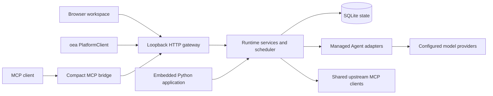

# Architecture

Orchestrate Everything with Agents combines a Python library, a durable local host, MCP bridges and a browser workspace. These surfaces call the same application services; the frontend and bridges do not contain separate schedulers.

The [workbench](workbench.md) shares file, command, image and delivery semantics through RunContext and ToolGateway. External environment versions and task snapshots live in SQLite. Local commands reuse owned process trees and require a host startup grant; file authorization does not imply system isolation. LangGraph can receive an ephemeral managed context while keeping its own persistent graph state separate.

## Domain model

A project owns its Agent configurations, sessions and reusable workflows. A session contains independent Agent threads. A task records a durable execution request and its attempts; a run records one concrete adapter execution. Collaboration messages carry full context between checked thread scopes. Artifacts are managed files addressed by ID.

A workflow is a versioned project-owned DAG. Its run snapshots the definition and uses an explicitly selected session or creates an ordinary session. Agent nodes submit ordinary tasks, so concurrency budgets, tool bindings, model snapshots, checkpoints and cancellation share the same runtime contracts. Template and condition nodes are deterministic and do not consume model slots.

## Managed instances and parallel workflows

Instance batches are durable request receipts over ordinary threads and tasks. Each member has an input ordinal and fixed Agent assignment; batches add a concurrency cap without creating another scheduler. Round-robin and capacity-normalized least-loaded routing operate within a project's managed Agent pool. A run-scoped parent may spawn a batch only in its current session, then suspend while waiting. Parent failure/cancellation requests cancellation of its child batches.

Map workflow nodes create batches atomically with node advancement and aggregate all successful outputs in input order. Empty input completes without tasks. Their immutable graph snapshots, recovery, cancellation and uncertain outcomes use the same contracts as ordinary Agent nodes. The scheduler batches dependency and ownership reads, retains session round-robin fairness, and counts uncertain executions against both Agent and batch capacity. Immutable graph execution plans are cached for active workflow runs.

## Persistence and recovery

SQLite stores durable state and receipts on a local disk outside source repositories. The host takes an exclusive workspace lock. Schema upgrades retain migration checksums and create pre-upgrade backups. Event sequence numbers support bounded event replay; transient token streams are replaced by persisted results after reconnect.

Tasks may queue, run, wait, finish, fail, cancel or become uncertain. A timeout is not proof that external work stopped. Uncertain executions retain resources until reconciliation records actual evidence. Idempotent submissions and atomic boundary receipts prevent ordinary client retries from creating duplicate work; they do not promise exactly-once effects in arbitrary external systems.

A session can hold independent workflow runs and ordinary conversations. Thread origin and task execution ownership are recorded separately in the creation transaction. Workflow cancellation, completion and uncertainty aggregate owned executions, including linked child instances, rather than all tasks in the session. The original strict thread snapshot stays stable; origin information has an explicit `threads.ownership` view.

Browser read state is a projection over immutable conversation messages, collaboration messages and reports. Per-thread activity and exact read positions are durable; reading does not consume an Agent message or resolve a guidance request. The overview and sidebar use the same grouped instance information and the same SSE refresh path.

RPC commands have one registered handler and execute directly through the shared services. Durable business mutations and their events commit together; response loss recovers the original domain receipt. Transient progress uses a separate bounded buffer and can request resynchronization without blocking control commands. Delivery receipts distinguish accepted inbox storage, offering, transport confirmation, application and explicit rejection or expiration. Application is recorded with the persistent run boundary, independently of browser read state.

Managed JSONL peers can negotiate a logical channel extension without changing the execution request schema. Each binding fixes the run, Thread, connection and generation. A transfer cannot occur during an in-flight callback, and old generations cannot write. Received-message positions advance only over a contiguous prefix; acknowledgment alone never marks a message applied. Reconnecting a logical channel does not start another execution. A disconnected or crashed managed process still follows the existing probe, checkpoint and reconciliation contracts.

Native chat checkpoints store immutable linked segments. Model preparation reads a bounded tail directly, and branches share a cache keyed by their immutable head and byte budget. Complete native history remains available through checkpoint-pinned pages. Evidence merges save fixed source heads, the target revision, selected content hashes and explicit conflict resolutions. They preserve the target's execution checkpoint and main conversation path. A later execution inherits the merged references; a fork at an earlier checkpoint does not inherit later merges.

Thread directory bindings optionally provide a persistent managed directory or a detached Git worktree at a fixed commit. Preparation has a durable intent and never overwrites existing changed files to recover an interrupted request. Bound file tools write to the thread directory and keep the project mount read-only. These directory boundaries do not isolate trusted local processes from the host operating system.

## Execution and access

The session operations channel shares ordinary tasks, messages and durable events. A coordinator can actively inspect or test and passively receive compact reports; run-bound Agents can suspend for guidance. Internal notifications are coalesced and preserve unfinished task waits. Diagnostic work uses the same scheduler and grants. External chat activation belongs to its client, while the platform supplies event subscriptions and bounded inbox waits. See [operations and guidance](operations.md).

Browser supervision uses Agent status colors in the existing views. It has no separate operations page or operations REST routes; reports and guidance remain Agent-facing SDK/RPC/MCP capabilities. Compact pending-report thread IDs join the existing session presentation and event refresh path without background polling.

Adapters may run in-process or as managed JSONL subprocesses. Cancellation and checkpoint capabilities are explicitly described. The runtime controls global capacity, per-Agent concurrency and declared resources. Model settings are snapshotted per run; secrets are supplied from local encrypted storage. Skills and `AGENT.md` are loaded as instructions, with skill bodies read on demand.

One resource coordinator admits quantity claims together with shared/exclusive targets. Global, Agent and batch execution claims remain held until the execution actually stops; model and MCP call claims cover their own phases. External leases have durable queued, granted, isolated and released receipts. Expiry and host recovery isolate granted leases until their owner provides stop evidence. Capacity preflight reads current availability without reserving it.

Local execution stop and unresolved remote effects have separate resource lifetimes. A machine-confirmed local stop can return execution slots while the task remains uncertain and its remote claims stay held. Explicit run-bound leases follow their owner run's actual exit. MCP responses observed after a caller leaves can settle the original receipt and return capacity automatically, without replaying the operation. Connection generations fence old callbacks; idle closure runs outside the registry lock, and unused consumer capacity definitions are retired with their physical connections. This housekeeping uses bounded host work and no model calls.

MCP tool calls and resource/prompt requests obey both service-wide and per-connection limits. Connection handshakes and catalog discovery have separate bounded startup and connection admission. A cached tool catalog does not create one connection per Thread. Persistent consumers retain their selection; explicitly stateless or reinitializable consumers may be reclaimed while idle. Reinitialization uses configured connection-state-only tools with current authorization, before the requested call. Actual connection handshakes and schema fingerprints are checked against the discovery snapshot. An unresolved invocation retains its call and connection capacity across restart; resolving capacity does not invent an upstream result.

Model requests share deterministic instruction assembly, context projection, phase admission and durable usage accounting across native and custom execution adapters. Cumulative budgets belong to task lineages or explicitly shared session budgets. Their reservations commit with model stages and tool intents; retries, summaries, descendants and repairs retain the same ledger. Elapsed and stalled-loop limits stop work without discarding available partial output.

Message delivery owns offering, application, transport receipts and resetting uncommitted offers. Channel generation ownership is separate. Both modules receive only storage and the callbacks they need; the Runtime joins their writes to its existing boundary transaction. Public SDK modules expose shared contracts and run-bound capabilities, while the remote client can load without starting host services or importing optional execution frameworks.

Agent tool access must satisfy both the run snapshot and current bindings. Administrator APIs are broader and must not be used by an Agent to evade revoked access. MCP tool results, messages, logs and imported skill text are untrusted inputs. Local process isolation is not a security sandbox.

## Source map

| Path | Responsibility |
| --- | --- |
| `src/oea` | Public SDK and command entry points |
| `src/ma_runtime` | Runtime implementation and compatibility imports |
| `agent` | Built-in, subprocess and framework adapters |
| `src/ma_runtime/web/static` | Browser workspace, SVG identity and canvas |
| `src/ma_runtime/bridges` | MCP, STDIO and RPC dispatch |
| `integrations/codex` | Discoverable Codex skill and focused workflows |
| `examples` | Generic executable SDK examples |
| `tests` | Automated contracts with temporary synthetic state |
