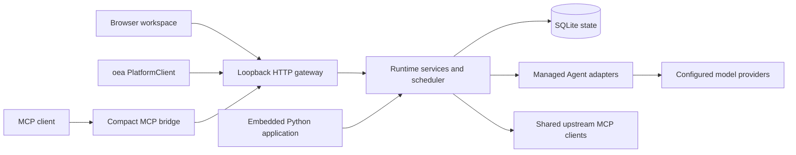

# Architecture

Orchestrate Everything with Agents combines a Python library, a durable local host, MCP bridges and a browser workspace. These surfaces call the same application services; the frontend and bridges do not contain separate schedulers.

## Domain model

A project owns its Agent configurations, sessions and reusable workflows. A session contains independent Agent threads. A task records a durable execution request and its attempts; a run records one concrete adapter execution. Collaboration messages carry full context between checked thread scopes. Artifacts are managed files addressed by ID.

A workflow is a versioned project-owned DAG. Its run snapshots the definition and creates an ordinary session. Agent nodes submit ordinary tasks, so concurrency budgets, tool bindings, model snapshots, checkpoints and cancellation share the same runtime contracts. Template and condition nodes are deterministic and do not consume model slots.

## Persistence and recovery

SQLite stores durable state and receipts on a local disk outside source repositories. The host takes an exclusive workspace lock. Schema upgrades retain migration checksums and create pre-upgrade backups. Event sequence numbers support bounded event replay; transient token streams are replaced by persisted results after reconnect.

Tasks may queue, run, wait, finish, fail, cancel or become uncertain. A timeout is not proof that external work stopped. Uncertain executions retain resources until reconciliation records actual evidence. Idempotent submissions and atomic boundary receipts prevent ordinary client retries from creating duplicate work; they do not promise exactly-once effects in arbitrary external systems.

## Execution and access

Adapters may run in-process or as managed JSONL subprocesses. Cancellation and checkpoint capabilities are explicitly described. The runtime controls global capacity, per-Agent concurrency and declared resources. Model settings are snapshotted per run; secrets are supplied from local encrypted storage. Skills and `AGENT.md` are loaded as instructions, with skill bodies read on demand.

Agent tool access must satisfy both the run snapshot and current bindings. Administrator APIs are broader and must not be used by an Agent to evade revoked access. MCP tool results, messages, logs and imported skill text are untrusted inputs. Local process isolation is not a security sandbox.

## Source map

| Path | Responsibility |
| --- | --- |
| `src/oea` | Public SDK and command entry points |
| `src/ma_runtime` | Runtime implementation and compatibility imports |
| `agent` | Built-in, subprocess and framework adapters |
| `src/ma_runtime/web/static` | Browser workspace, SVG identity and canvas |
| `src/ma_runtime/bridges` | MCP, STDIO and RPC dispatch |
| `integrations/codex` | Discoverable Codex skill and focused workflows |
| `examples` | Generic executable SDK examples |
| `tests` | Automated contracts with temporary synthetic state |
