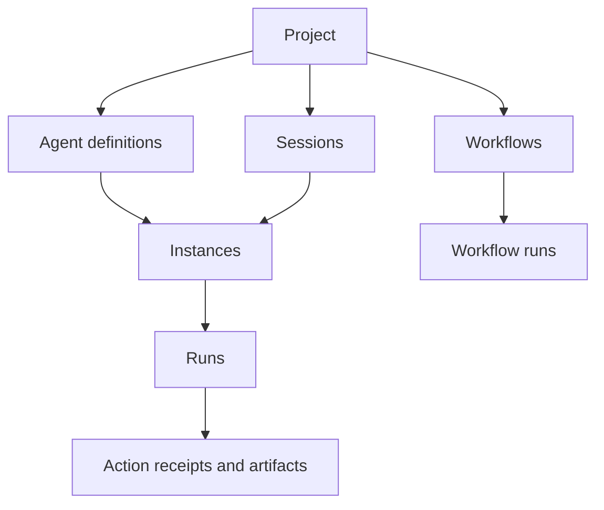

# OEA User Guide

English · [简体中文](user-guide.zh-CN.md) · [Documentation](README.md)

This guide explains how to use Orchestrate Everything with Agents (OEA) 2.0.3, from your first local conversation to tools, collaboration and reusable workflows. Start with the browser sections if you want to configure and supervise work; use the SDK and MCP sections when you want to integrate OEA into another application or Agent client. The current browser interface uses Chinese labels, which are included alongside their English descriptions below.

## Contents

1. [Choose a way to work](#choose)
2. [Understand the core concepts](#concepts)
3. [Install and start OEA](#install)
4. [Complete your first Agent task](#first-task)
5. [Find your way around the workspace](#workspace)
6. [Configure an Agent](#configuration)
7. [Give an Agent tools and files](#tools)
8. [Register and use Skills](#skills)
9. [Work with multiple instances](#collaboration)
10. [Build a reusable workflow](#workflows)
11. [Read results, budgets and recovery states](#results)
12. [Use the Python SDK](#sdk)
13. [Connect an Agent client through MCP](#mcp)
14. [Maintain your installation and data](#maintenance)
15. [Troubleshoot common problems](#troubleshooting)
16. [Continue with the reference documentation](#references)

<a id="choose"></a>
## 1. Choose a way to work

OEA is a personal, local platform for developing and coordinating Agents. A main Agent can understand a goal, delegate independent work and verify the results. LangGraph executes the graphs; a local host keeps configuration, permissions, budgets, history and durable receipts. The browser lets you configure capabilities and supervise the work.

| Your goal | Start here |
| --- | --- |
| Ask one Agent to complete a task | Create an Agent and open its conversation |
| Keep separate contexts for several tasks | Create independent instances of the same Agent |
| Coordinate different capabilities | Configure communication and use explicit collaborative mode |
| Repeat a defined process | Build a workflow on the canvas or with `WorkflowBuilder` |
| Embed an Agent in Python | Use the `Agent` SDK |
| Let another Agent client operate OEA | Connect the platform control MCP and use its Skill |
| Connect an external tool service | Register a business MCP service and bind its selected tools |

Use ordinary functions or workflow nodes for deterministic work. Add an Agent when a responsibility needs its own reasoning, context or execution boundary. Model use requires a configured provider; deterministic workflows can run without a model.

<a id="concepts"></a>
## 2. Understand the core concepts

| Concept | Meaning | Practical example |
| --- | --- | --- |
| Host | The local service that owns one state directory | The service started by `oea serve` |
| Project | The ownership boundary for related work and configuration | A document-review project |
| Agent definition | Reusable model, instructions, tools and execution settings | A reviewer configuration |
| Instance | A stable execution identity with its own context, inbox and work directory | Two reviewers working on separate documents |
| Session | A collaboration and conversation space within a project | One review discussion |
| Run | One accepted work intent on an instance | Review one assigned document |
| Workflow / WorkflowRun | A reusable graph / one execution of that graph | Review, merge findings and deliver |
| Action receipt | The original result, error or unresolved outcome of a model or tool call | Whether a file-writing tool actually finished |
| Artifact | A registered file with source and ownership information | An uploaded input or a delivered report |
| Skill | Guidance that an Agent can load for a task | A reusable review procedure |
| Budget | Cumulative model/tool usage and time limits for related work | The allowance shared by a task and its child work |

An Agent definition can have many instances. Reopening an instance continues its history; creating a new instance gives you a separate context. A new task creates a Run on that instance. Independent instances can execute concurrently; one instance has one writer for its mutable context.



The browser, SDK client and control MCP connect to the same host. A standalone SDK Agent can own an isolated host; its state is separate from the main browser workspace.

<a id="install"></a>
## 3. Install and start OEA

Use `oea` on Windows, Linux and macOS. For everyday platform use, install it as a global command-line tool with uv. To import the SDK or manage a Python environment yourself, use the separate Python-environment steps below.

### Recommended: install the platform with uv

Install [uv](https://docs.astral.sh/uv/getting-started/installation/), download or clone the OEA source, and open a terminal at the directory containing `pyproject.toml` and `constraints.txt`. Use the same commands in Windows PowerShell, Windows Command Prompt, Linux bash or macOS zsh:

```sh
uv tool install --python 3.12 -c constraints.txt ".[web,mcp,workbench]"
uv tool update-shell
```

Reopen the terminal, then verify and start OEA from any directory:

```sh
oea --version
oea serve
```

uv manages an isolated tool environment and exposes `oea` on your user's PATH. Everyday commands need no manual environment activation. OEA requires Python **3.12+**; the command selects Python 3.12, which uv can download when needed according to its settings. The installation reads the local source and constraints file. See [quick installation](getting-started.md#quick-install).

### SDK or manually managed Python environment

To run code that imports `oea`, install it in that code's Python environment. A uv tool installation does not expose the module to another Python interpreter. Install Python **3.12 or newer**, open a terminal at the repository root, and choose the steps for your shell. These also provide a platform installation alternative for users who prefer managing the environment themselves.

#### Windows PowerShell

```powershell
python -m venv "$env:USERPROFILE\.venvs\oea"
& "$env:USERPROFILE\.venvs\oea\Scripts\Activate.ps1"
$env:PYTHONDONTWRITEBYTECODE = "1"
python -m pip install -c constraints.txt ".[web,mcp,workbench]"
oea serve
```

If policy prevents activation scripts, use the environment's executables directly as shown in [PowerShell setup](getting-started.md#windows-powershell).

#### Windows Command Prompt (cmd.exe)

```bat
python -m venv "%USERPROFILE%\.venvs\oea"
call "%USERPROFILE%\.venvs\oea\Scripts\activate.bat"
set PYTHONDONTWRITEBYTECODE=1
python -m pip install -c constraints.txt ".[web,mcp,workbench]"
oea serve
```

#### Linux and macOS (bash / zsh)

These commands work on both systems. Ensure `python3` selects Python 3.12+ with the `venv` module available:

```sh
python3 -m venv "$HOME/.venvs/oea"
. "$HOME/.venvs/oea/bin/activate"
export PYTHONDONTWRITEBYTECODE=1
python -m pip install -c constraints.txt ".[web,mcp,workbench]"
oea serve
```

For a manually managed installation, activate the same environment when running SDK code or platform commands. After the recommended uv installation, run `oea serve` directly from any directory. A newly started server runs in the foreground and keeps the terminal occupied. Open its printed URL in your browser; the first-launch default is [http://127.0.0.1:8890](http://127.0.0.1:8890). Use another terminal for client commands. `Ctrl+C` stops the foreground server. Closing a browser tab leaves it running. A launch against an authenticated running host reuses it.

### Check the installation

```sh
oea --version
oea paths
oea request host.status
```

The version and paths commands inspect the installation. `host.status` needs a running host. The browser establishes an authenticated local session; clients discover the host from its saved connection information. Restart MCP clients after `uv tool update-shell`. A client that still cannot find `oea` can use its absolute executable path; see [client command lookup](getting-started.md#mcp-client).

By default, OEA uses `~/.oea` (`%USERPROFILE%\.oea` on Windows):

| Directory | Purpose |
| --- | --- |
| `data/` | Databases, checkpoints, secrets, connection information, managed workspaces and artifacts |
| `runtime/` | Python environment created by the optional Windows installer |
| `cache/` | Caches used by managed installation workflows |
| `bin/` | Command and launchers installed by the optional Windows installer |

With uv, its tool environment and exposed command are managed separately from OEA state. With pip, the command remains in your chosen environment. The optional managed directories need not exist with either installation. `oea paths` only reports locations, while `oea serve` creates the selected data directory on first use. Keep runtime state on local disk, outside source repositories and synchronized folders. The saved port is reused on later launches. `OEA_HOME` can select an explicit absolute home for an isolated installation; changing it does not move existing data. See [getting started](getting-started.md) for advanced path options.

### Optional Windows convenience scripts

If you prefer a Windows managed runtime and double-click launch, run `Install-OEA.cmd` from the source distribution, then `Start-Workspace.cmd`. This is an optional platform installation alternative. The installer prepares the external managed runtime and adds its command directory to the user PATH; reopen terminals and MCP clients after installation. The launcher starts the host in the background or reuses it, and opens the browser. You can still use `oea serve` and `oea mcp`. See [Windows shortcuts](getting-started.md#windows-shortcuts) for options.

<a id="first-task"></a>
## 4. Complete your first Agent task

Start with a small text task so you can verify the model configuration before adding file or command tools.

1. Open the project menu beside **当前项目** and choose **新建项目** (New project). Give the project a descriptive name.
2. Use the menu beside **当前会话** to create a session with **新建会话** (New session).
3. Open **Agent**, add an Agent, and provide a name and stable ID such as `reviewer`. Creating the draft does not save a working configuration yet.
4. In **职责与模型** (Role and model), enter the provider's API base URL, exact model name and your instructions. Enter the credential in **主模型密钥** (Main model key) when required by the provider.
5. Save the configuration with the checkmark control labelled **保存配置**. Use **检查已保存配置** to inspect missing fields, credential availability, tool bindings, program lookup and path readiness. This check does not call a model.
6. Return to **工作台 → 总览** (Workbench → Overview), then choose **进入对话** on the Agent card. With no existing instance, OEA opens a draft conversation; the first message creates the stable instance.
7. Send a small goal, such as asking for a concise explanation of a familiar programming concept. State the expected language and deliverable. `Enter` sends; `Shift + Enter` inserts a newline.
8. Read the reply and check the Run state. Open **任务详情** (Task details) for timing, usage and errors. Expand **执行活动 → 查看调用记录** to inspect the original action evidence when needed.

A saved configuration or an **已配置** label shows setup information. Successful real execution and a useful deliverable require their own results. Starting OEA or adding an Agent does not automatically submit demonstration work.

If the task fails, keep the original task identity and inspect the error before submitting more work. The [troubleshooting table](#troubleshooting) explains common causes.

<a id="workspace"></a>
## 5. Find your way around the workspace

Select the project and session before acting on their work. The main navigation is:

| Area | What you do there |
| --- | --- |
| **工作台** — Workbench | Open **总览**, **协作消息** and **工作产物**, plus instance conversation tabs |
| **Agent** | Manage reusable Agent definitions and open their configuration |
| **工作流** — Workflows | Create and inspect project graphs and their executions |
| **MCP 工具** — MCP tools | Register services, discover tools and inspect tool calls |
| **Skills** | Register Skill directories and read their instructions and references |
| **设置与配置** — Settings | Edit the selected Agent's configuration groups |
| **回收站** — Recycle bin | Find and restore archived sessions for the current project |

**最近任务** on the overview and the task panel inside a conversation open the original task details. Those details link back to the instance conversation. Use **搜索或快速跳转** to find loaded projects, sessions, Agents and instances by name.

An Agent with one instance opens directly; an Agent with several instances opens a selector. Use **添加实例** in collaboration or **新建独立对话** in the instance selector to start separate work. Closing a conversation tab does not delete its instance or cancel its Run.

Unread markers track new conversation or collaboration content. Reading the latest content in a visible window advances the corresponding read position. Older pages and long responses remain available through their history and original-content controls.

<a id="configuration"></a>
## 6. Configure an Agent

Open an Agent's gear control to edit its settings. Save changes before starting new work. Configuration revisions prevent one editor from silently overwriting a newer saved definition; reload and reconcile your draft if you receive a revision conflict.

| Configuration group | What to decide |
| --- | --- |
| **职责与模型** — Role and model | Responsibility, instructions, provider, model name, credential, output length and model-specific options |
| **工具与 Skills** — Tools and Skills | Which local, function and MCP tools the Agent can use; which Skills it can read |
| **上下文与记忆** — Context and memory | Active input size, recent history, tool-result size and stage-memory allowance |
| **工作目录与环境** — Workspace and environment | Input directory, instance work directory, read-only references and explicitly writable project paths |
| **执行与交付** — Execution and delivery | Execution graph or process program, cumulative budget and required deliverables |
| **通信与 manager** — Communication and manager | Allowed partner Agents, work-request permission and a separately configured manager |

The built-in model transport uses OpenAI-compatible Chat Completions. Enter the provider's API base prefix; OEA appends `/chat/completions`. Choose options supported by that provider. The model's context-window setting and reserved output must fit its actual limits. Increase input capacity only when the model supports it. Model output, recent history, tools and images all consume context.

Keep credentials in the secret field or a supported `env:` / `vault:` reference. Saved secret values are not displayed again. Leaving the password input empty preserves an existing binding; detaching it is a separate action. A manager has its own model and secret, with no automatic fallback to the main model.

New work uses accepted configuration snapshots. Current permission revocation takes effect at execution boundaries. Changing a default path does not move an existing instance's files. For advanced fields, use [the SDK guide](sdk.md) or inspect the current shared schema:

```sh
oea schema agent
```

<a id="tools"></a>
## 7. Give an Agent tools and files

### Local file and command tools

Local capabilities include reading and searching files, writing and editing files, running commands, reading images and publishing artifacts. Bind only the tools needed by the task in **工具与 Skills**.

In **工作目录与环境**, distinguish:

- **Project input**: existing source material, read-only by default.
- **Instance work directory**: the instance's persistent working area.
- **Run output directory**: files produced by one Run.
- **References**: additional read-only material.
- **Writable project paths**: explicit exceptions for file-tool edits to selected project subpaths.

File tools enforce their path grants. Commands run with the host user's operating-system permissions, so file-tool restrictions do not sandbox a shell or process Agent. To use configured command tools or process Agents, start an idle host with that capability enabled:

```sh
oea serve --allow-commands
```

The Windows launcher accepts `-AllowCommands`. If a host is already running, reconnecting retains its original command grant; stop that host before changing startup permissions. External programs must be installed in their selected environment and available by the configured executable path.

### Inputs and deliverables

Use the attachment control in a conversation to upload and assign files to the task. Keep the inserted `ArtifactRef` line in the message when sending that task. An artifact stored in the project is not automatically assigned to every Agent. State which source to use and what output you expect.

Use **工作产物** (Work artifacts) to inspect source information, preview supported content and download the original file. A preview may show a bounded amount of content; use the original download or original action receipt for the complete evidence. A claimed filename in model prose is not a registered deliverable. If a file is required, bind publishing capability and configure the minimum artifact requirement under delivery settings.

For a first file task, enable reading, writing and artifact publishing, attach a document, and ask the Agent to produce a summary in its Run output directory and publish it. After completion, check the artifact record and download the file to verify its contents. This exercises input assignment, tool execution and delivery together.

### Business MCP tools

1. Open **MCP 工具** and register a service using its documented local program or HTTP connection settings. You can also selectively import supported entries from a local Codex TOML configuration.
2. Store service credentials through secret references. Imported configuration is saved before you separately initiate connection and discovery.
3. Discover the service's current tool catalog. A saved service, a successful discovery and a successful tool call are separate results.
4. Bind the selected service and upstream tool names to the Agent in **工具与 Skills**, then save its configuration.
5. Run one small, intended task and inspect the original tool receipt. An explicit tool trial can itself perform the tool's documented action.

The platform control MCP in [section 13](#mcp) operates OEA itself. Business MCP supplies capabilities to work performed through OEA. Keep those connections separate. See [workbench](workbench.md) and [MCP](mcp.md) for details.

<a id="skills"></a>
## 8. Register and use Skills

A Skill supplies instructions; its tools still need their own grants.

1. Prepare an external directory containing `SKILL.md` and any referenced files.
2. Open **Skills**, enter its directory in **注册 Skill 目录**, and register it.
3. Inspect its description, Markdown and reference files.
4. Bind the Skill to an Agent in **工具与 Skills**. Mark it required when its instructions must be loaded before execution, then save the Agent.
5. Validate it with one relevant task and check the actual result and execution evidence.

Registration retains a content revision. After changing source files, refresh the registered Skill to adopt that revision. Disabling or removing a registration withdraws its availability and preserves its original directory. An accepted configuration can pin a Skill revision; check the binding when adopting an update.

Skill text, imported documents and tool output cannot grant permission or change the user's goal. See [Skills and execution policies](skills.md).

<a id="collaboration"></a>
## 9. Work with multiple instances

### Separate independent tasks

Create several instances when the same Agent definition needs independent histories or work directories. For example, assign different input files to different reviewer instances. Send one explicit goal to each. Their Runs can proceed concurrently; cumulative budgets and provider limits still apply.

Reuse an existing instance for follow-up work that needs its context. Use a new instance when the task should begin with a separate history. OEA does not provide global, Agent, model or MCP execution-slot quotas. Budget settings limit work cost and time rather than concurrent resource admission.

### Direct and collaborative modes

Start with `direct` mode when addressing known instances yourself. Use `collaborative` mode when you want a configured manager to coordinate work through its allowed partner and instance tools.

To use collaboration, configure the Agent's **通信与 manager** group, including the manager's separate model, credential and instructions. Grant the needed partner scope and work-request permission. In **协作消息**, select collaborative mode and choose the intended Agent coordination target or instance recipients.

A manager has coordination capabilities within the accepted goal and root budget. It does not inherit business shell tools or the main model's credentials. Changing the session mode does not rewrite already accepted work.

### Choose the message purpose

| Purpose | Browser label | Effect |
| --- | --- | --- |
| `inform` | 资料消息 | Adds information to recipients' inboxes without starting inference |
| `request` | 工作请求 | Submits explicitly authorized work under its work ownership and budget |
| `reply` | 答复原工作 | Answers or continues the associated original work |
| `report` | 进展与问题 | Records facts or issues without independently starting work |

Select recipients through the recipient controls. Acceptance freezes the actual recipient set; a later membership change does not change that message's recipients. Writing an `@` mention in prose alone does not create an authorized request. Ordinary information or broadcast messages do not implicitly run every Agent.

Inspect the message receipt to distinguish inbox acceptance, application and completed work. Send references to complete artifacts and original results when handing work over. A manager turn ending does not automatically cancel its child work. See [collaboration](collaboration.md).

<a id="workflows"></a>
## 10. Build a reusable workflow

A workflow belongs to one project and expresses a repeatable process. Use the browser canvas for declarative graphs. Registered Python code graphs show their topology for inspection and are maintained in code.

### Canvas workflow

1. Select a project and open **工作流**.
2. Create a definition and connect a start node, the work nodes and an end node.
3. Define the expected input and map earlier outputs into later nodes.
4. Save the draft, then validate it. A draft can be incomplete; execution requires a valid complete graph, available capabilities and valid input.
5. Run it with explicit input. Inspect the workflow and node states, child Runs and output artifacts.

The canvas also imports and exports workflow definitions, and provides archive, delete and restore controls. Export contains the graph definition; it does not bundle the secret store or runtime database. After importing into a project, check its Agent, function and subgraph references. Saving uses a revision check, so reconcile a newer saved version before overwriting it.

| Node or graph feature | Use it for |
| --- | --- |
| Start / end | Input contract and final outputs |
| Agent | A task for an existing Agent capability |
| Map | Independent per-item work with ordered member results |
| Template / function | Deterministic transformation; functions are registered in the host |
| Condition / loop | Branching and repeated graph steps |
| Subgraph | Reusing another workflow |
| Human wait | Persisting progress until a supplied answer |
| Join | Collecting parallel paths or merging alternatives |

Templates reference `inputs`, `nodes`, `item` and `index`. For example, `{{inputs.name}}` reads a workflow input. Parallel joins use `all`; alternative paths can use `any`. Put side effects in authorized tools and keep deterministic function nodes pure.

### Run a complete example without a model

Start the normal host first, and prepare a Python environment with the [SDK installation steps](getting-started.md#sdk-installation) for this code example. Save the script outside the repository and run it with that environment's Python. Each deliberate execution creates one project, one workflow and one workflow run; it does not configure a model or invoke one.

```python
import asyncio
import uuid

from oea import PlatformClient, WorkflowBuilder


async def main():
    graph = (
        WorkflowBuilder()
        .node("start", "start")
        .node("format", "template", value={"text": "Hello, {{inputs.name}}."})
        .node("end", "end", outputs={"text": "{{nodes.format.text}}"})
        .connect("start", "format")
        .connect("format", "end")
        .build()
    )
    async with PlatformClient.from_data_dir() as client:
        project = await client.call("projects.create", {"name": "Guide example"})
        workflow = await client.call("workflows.create", {
            "project_id": project["id"],
            "name": "Greeting",
            "graph": graph.model_dump(mode="json"),
        })
        key = "guide-" + uuid.uuid4().hex
        receipt = await client.call("workflows.run", {
            "project_id": project["id"],
            "workflow_id": workflow["id"],
            "inputs": {"name": "world"},
            "idempotency_key": key,
        })
        print("Project:", project["id"], "Run:", receipt["id"], "Key:", key)
        result = await client.call("workflows.result", {
            "project_id": project["id"],
            "workflow_run_id": receipt["id"],
            "timeout": 10,
        })
        print(result["text"])


if __name__ == "__main__":
    asyncio.run(main())
```

The final text should be `Hello, world.`. Keep the printed project, Run and key when inspecting that execution. A response loss is handled by reading the original receipt; rerunning the whole script creates new work.

Waiting workflows preserve their native interrupt and child receipts. Use the original workflow Run and interrupt when resuming. Repair can target a failed node; inspect preserved successful results before deciding what to continue. See [workflows](workflows.md) and [SDK graph examples](sdk.md#business-graphs).

<a id="results"></a>
## 11. Read results, budgets and recovery states

### Understand the state

| State | Meaning | Next step |
| --- | --- | --- |
| `accepted` | Work has been durably accepted | Observe the original Run |
| `running` | Work is executing | Read progress, receipts and usage |
| `waiting` | Progress is suspended for input or a dependency | Read the wait reason; answer the original wait or observe its child work |
| `completed` | Execution and its delivery checks finished | Review the actual text, structured data and artifacts |
| `failed` | Work hit a known failure | Inspect errors and partial results; correct the cause before explicit continuation |
| `cancelled` | The Run is cancelled | Inspect any separate unresolved external actions |
| `needs_review` | An action outcome requires verification | Check the real effect before recording a conclusion or continuing |

Task details show elapsed time, budget accounting and diagnostics. Execution activities link to original model and tool calls. Provider-reported tokens, estimates, in-flight reservations and unresolved usage are separate values; unknown usage is shown as unknown. Token totals alone do not establish a billing amount.

Root and child work, including manager coordination and repairs, share their inherited cumulative budget. Choose limits in **执行与交付** for model calls, input/output tokens, tool calls, elapsed time and stalled work. One model response's output limit is separate from the whole work's output-token budget.

### Continue safely

- For new follow-up work, send a new goal to the instance.
- To continue suspended or failed work, use the original Run through the SDK or MCP recovery operation, or reply to a valid associated wait. The browser conversation composer sends new work; it is not a general checkpoint-resume control.
- If a response was lost, read the original receipt. Programmatic retries of the same intended submission keep its original idempotency key and content; new intended work uses a new key.
- Request stopping with the conversation's stop control. Check the eventual execution evidence: a request to stop, a confirmed stop and an unknown external result are separate observations.
- If a tool may already have changed an external system, verify the original effect. Confirmation records evidence and the real result; it does not resend the action. The shared operations include `runs.confirm_action` and `mcp.confirm_call`.

Partial text, files and original receipts can remain useful after a failure. Execution completion and business correctness need separate review. See [supervision and guidance](operations.md) and [delivery evidence](execution-quality.md).

<a id="sdk"></a>
## 12. Use the Python SDK

### An isolated Agent

Use a Python environment prepared with the [SDK installation steps](getting-started.md#sdk-installation). Configure `OPENAI_BASE_URL`, `OPENAI_MODEL` and `OPENAI_API_KEY` in your local environment for your chosen OpenAI-compatible provider. The following example performs a real model task and can incur provider usage. Save it outside the repository and run it in the environment containing OEA:

```python
from pathlib import Path

from oea import Agent, Model, ToolKit, tool


@tool
def total(values: list[int]) -> int:
    return sum(values)


with Agent(
    name="guide-agent",
    model=Model.from_env(),
    instructions="Use the total tool for addition and explain the result briefly.",
    tools=ToolKit.local(files=False).with_tools(total),
    state_dir=Path.home() / ".oea" / "sdk" / "guide-agent",
) as agent:
    result = agent.instance("first").run("Add 10, 20 and 30.")
    print(result.text)
```

The Agent owns this isolated SDK state and closes its resources on exit. Construction alone does not start a model or host. This example's state is separate from the main browser host. Use typed parameters for function tools and declare `side_effects="local"` or `"external"` when a function changes state.

### An existing browser workspace

Connect with `PlatformClient.from_data_dir()` to manage the running main host. To execute a definition already saved there, use `Agent.from_saved` with the client and an explicit session or project. The ordinary `Agent(...)` constructor declares and saves the definition you supply.

Use `arun` / `astream` and asynchronous context managers in an application that already has an event loop. Keep a client and Agent on their original event loop. New Python function implementations must be registered in the host process before a remote binding can use them.

For executable examples and advanced lifecycle, stream and recovery contracts, see [Python SDK](sdk.md), [model Agent example](../examples/model_agent.py) and [process Agent example](../examples/integration_agent.py). Process Agents implement OEA's v2 UTF-8 JSONL protocol; an arbitrary console script is not automatically an OEA Agent.

<a id="mcp"></a>
## 13. Connect an Agent client through MCP

1. Start the OEA host and confirm its project and data directory.
2. In your MCP-capable client, configure the stdio command `oea` with arguments `["mcp"]`. The client must be able to find the installed command and reach the local host. If its PATH does not include your Python environment, use the absolute executable path found with the [command lookup instructions](getting-started.md#mcp-client).
3. Restart the MCP client after `uv tool update-shell` or other PATH changes.
4. If using the supplied control Skill, export it to a new external directory and install that directory through the client's Skill mechanism. Replace the destination below with your intended new absolute directory:

```sh
oea export-skill --output EXTERNAL_NEW_SKILL_DIRECTORY
```

Export refuses an existing destination so locally edited instructions are preserved. The bundled [OEA control Skill](../integrations/codex/orchestrate-everything-with-agents/SKILL.md) routes configuration, execution, collaboration and maintenance to focused instructions.

The control bridge provides two tools:

| Tool | Purpose |
| --- | --- |
| `platform_guide` | Discover one capability area or exact action and its current parameters |
| `platform_call` | Execute one discovered shared operation |

Use a stable `consumer_id` throughout one conversation and distinct IDs for independent conversations. Keep the owning project in operations that require it. Lists are paginated. Large results return a `result_ref`; use `results.read` and the required JSON Pointer to read the relevant portion. Reading a reference does not repeat the original action.

The bridge connects to the existing OEA host; it does not create a new workspace for each client conversation. Your MCP client's cache is separate from OEA's durable state. Keep business MCP registrations separate from the OEA control bridge to avoid connecting the platform back to itself. See [MCP and Skills](mcp.md).

<a id="maintenance"></a>
## 14. Maintain your installation and data

### Sessions and projects

Archive a session through its settings when you want it removed from the active list. Restore it through the current project's recycle bin. Closing a tab and archiving a session have different effects.

Project deletion is permanent for its platform records and requires the exact project name. It is blocked while related execution or unresolved state makes deletion unsafe. It does not automatically remove original input directories, external work directories or offline backups. Review the affected project before confirming deletion.

### Stop, back up and update

Let active work settle or inspect its cancellation and unresolved outcomes before maintenance. For a foreground `oea serve`, use `Ctrl+C` in that server's terminal. When using the optional Windows launcher, it prints the background host PID and writes launcher logs under the selected data directory's `logs/`; verify that host identity before stopping a background process. Closing a browser or MCP client does not stop the host.

Stop the host before changing its installed environment or taking an offline backup. Preserve the complete state directory, including databases, graph checkpoints, secrets and their key material, artifacts and connection information. Back up external work/input directories separately when their contents are needed. Protect backups as private runtime data.

With the host stopped, update a uv-installed platform by [reinstalling the tool from the intended source version](getting-started.md#update-tool), then run `oea serve`. For a pip installation, activate its environment and rerun its package installation command against the updated source. An editable installation references the source checkout directly; frontend changes need a browser refresh and Python changes need an idle-host restart. If you chose the optional Windows managed installation, update it with its installer while that host is stopped. Installation updates do not relocate user data.

### State upgrades and migration

If the application reports a recognized v2 schema mismatch, inspect it offline with `oea upgrade-state` before applying an upgrade with a new backup destination. Conversion from supported legacy formats uses `oea migrate`, whose default is a read-only inspection and whose apply mode creates a separate new target.

Read the [migration guide](migration/README.md) before applying either operation. Changing `OEA_HOME`, copying a live database or opening a blank state directory does not migrate an existing workspace. Preserve the original data and reconcile newer facts before restoring any backup.

<a id="troubleshooting"></a>
## 15. Troubleshoot common problems

| Symptom | What to check and do |
| --- | --- |
| `oea` is not found | For uv, run `uv tool update-shell` and restart the terminal/client; for a manually managed environment, activate it or use its absolute executable path; optional Windows installer PATH changes also need a restart |
| The browser does not connect | Use the URL printed by the launcher, check the saved port and read the selected host's startup logs; verify ownership before starting another host |
| MCP reports no available host | Start OEA first; confirm that the client and host resolve the same home and data directory |
| The workspace looks empty | Check the selected project/session and `oea paths`; verify that an environment override did not select a different home before creating replacement data |
| A model request fails | Check the saved base URL, exact model name, credential source, provider-supported parameters and the original error/attempt; a configuration check does not establish connectivity |
| The manager fails while direct work succeeds | Check the manager's separate model, secret, instructions and communication scope |
| A local command or process cannot start | Check the host's original command grant, the Agent binding, executable path and selected environment |
| An MCP tool is unavailable | Check service enablement, project scope, discovery and the Agent's selected upstream tool binding; inspect an existing receipt before repeating a trial |
| A Skill update is not visible | Refresh its registration and review the revision bound to the Agent |
| Saving reports a revision conflict | Reload the latest saved configuration, reconcile the draft and save against that revision |
| Work remains `waiting` | Inspect whether it is waiting for human input or a child dependency; continue that original boundary |
| Work reports `needs_review` | Verify the original file or external-system effect; record evidence rather than resubmitting the action |
| An artifact preview or response looks shortened | Open the original file download or complete action content; check integrity diagnostics for actual provider truncation |
| A task completes but has no required file | Inspect registered artifacts and delivery requirements; grant publishing capability and specify the expected file for future work |
| Stop was requested but activity remains | Read the original action and stop evidence; a non-cancellable provider can settle later |
| Startup reports `DATA_RELOCATION_REQUIRED` or `SCHEMA_MISMATCH` | Preserve the existing data and use the documented offline inspection/upgrade/migration path; do not delete the database or switch to an empty directory to hide the error |

When reporting a problem, include the application version, operation, task/action identity and a bounded description of the error. Share only the necessary diagnostic excerpt; review it for credentials, private content and local identifiers before posting publicly. Use [SECURITY.md](../SECURITY.md) for sensitive reports.

<a id="references"></a>
## 16. Continue with the reference documentation

| Reference | Use it for |
| --- | --- |
| [Getting started](getting-started.md) | Advanced installation, paths and startup |
| [Python SDK](sdk.md) | Complete development, collaboration and recovery examples |
| [Workflows](workflows.md) | Graph execution and node behavior |
| [Workbench](workbench.md) | Local tools, program environments and files |
| [Skills](skills.md) | Registration, revisions and execution policies |
| [Collaboration](collaboration.md) | Message purposes, ownership and manager coordination |
| [Supervision](operations.md) | Original receipts, guidance and confirmation |
| [API](api.md) | Shared operations, transports and error contracts |
| [Architecture](architecture.md) | Host, LangGraph and persistence responsibilities |
| [Module interfaces](modules.md) | Per-module Python interfaces |
| [Contributing](../CONTRIBUTING.md) | Developing and validating framework changes |
