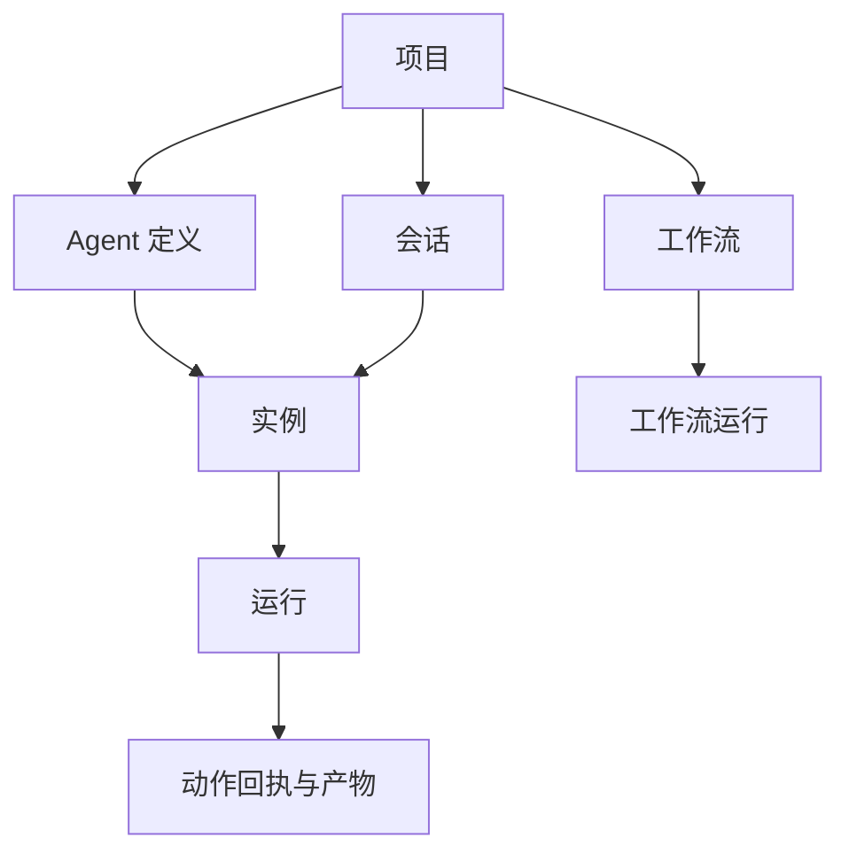

# OEA 用户指南

[English](user-guide.md) · 简体中文 · [文档目录](README.md)

本指南适用于 Orchestrate Everything with Agents（OEA）2.1.0，介绍从第一次本机对话，到工具、协作和可复用工作流的使用方式。希望通过界面配置和监督任务的用户，可以先阅读浏览器操作章节；需要开发或接入其他 Agent 客户端的用户，可以继续阅读 SDK 和 MCP 章节。

## 目录

1. [选择适合的使用方式](#choose)
2. [理解核心概念](#concepts)
3. [安装与启动](#install)
4. [完成第一个 Agent 任务](#first-task)
5. [认识工作区界面](#workspace)
6. [配置 Agent](#configuration)
7. [为 Agent 配置工具与文件](#tools)
8. [注册和使用 Skill](#skills)
9. [使用多个实例协作](#collaboration)
10. [创建可复用的工作流](#workflows)
11. [理解结果、预算与恢复状态](#results)
12. [使用 Python SDK](#sdk)
13. [通过 MCP 接入 Agent 客户端](#mcp)
14. [维护安装与运行数据](#maintenance)
15. [常见问题与排障](#troubleshooting)
16. [继续阅读参考文档](#references)

<a id="choose"></a>
## 1. 选择适合的使用方式

OEA 是面向个人的本机 Agent 开发与协作平台。主 Agent 可以理解目标、委派独立工作并核验成果；LangGraph 执行图；本机宿主保存配置、权限、预算、历史与持久回执；浏览器用于配置能力和监督执行。

| 想完成什么 | 从哪里开始 |
| --- | --- |
| 让一个 Agent 完成任务 | 创建 Agent，打开独立对话 |
| 同时处理几项需要独立上下文的工作 | 为同一 Agent 创建多个实例 |
| 协调不同能力共同完成目标 | 配置通信权限，显式开启协作模式 |
| 重复执行一个明确流程 | 在画布或 `WorkflowBuilder` 中创建工作流 |
| 在 Python 程序中嵌入 Agent | 使用 `Agent` SDK |
| 让其他 Agent 客户端操作 OEA | 接入平台控制 MCP，配合控制 Skill |
| 接入外部工具服务 | 注册业务 MCP 服务，绑定其中选定的工具 |

确定性的工作可以直接交给普通函数或工作流节点。职责、推理上下文或执行边界需要独立时，再使用 Agent。模型任务需要实际配置供应商；确定性工作流可以不调用模型。

<a id="concepts"></a>
## 2. 理解核心概念

| 概念 | 含义 | 使用中的例子 |
| --- | --- | --- |
| 宿主（Host） | 独占一个状态目录的本机服务 | `oea serve` 启动的服务 |
| 项目（Project） | 相关工作与配置的归属边界 | 一个文档审阅项目 |
| Agent 定义 | 可复用的模型、指令、工具与执行配置 | 一套审阅能力配置 |
| 实例（Instance） | 拥有独立上下文、邮箱和工作目录的稳定执行身份 | 分别审阅两份文件的两个实例 |
| 会话（Session） | 项目中的协作与对话空间 | 一次审阅讨论 |
| 运行（Run） | 实例接受的一次明确工作意图 | 审阅一份指定文档 |
| 工作流 / 工作流运行 | 可复用的图 / 该图的一次执行 | 审阅、汇总意见并交付 |
| 动作回执 | 模型或工具调用的原始结果、错误或未决事实 | 写文件的工具是否真正完成 |
| 产物（Artifact） | 带来源和归属信息的注册文件 | 上传的输入或交付的报告 |
| Skill | Agent 可按需读取的任务指导 | 可复用的审阅步骤 |
| 预算（Budget） | 关联工作的累计模型、工具用量与时间限制 | 一个任务及其子工作共用的额度 |

一个 Agent 定义可以创建多个实例。重新打开同一实例可以继续使用其历史；创建新实例会获得独立上下文。每次明确工作在实例上形成一个 Run。不同实例可并行执行，同一实例的可变上下文保持单写者。



浏览器、SDK 管理客户端和控制 MCP 连接同一个宿主。独立 SDK Agent 可以拥有隔离宿主，其状态与浏览器主工作区分开保存。

<a id="install"></a>
## 3. 安装与启动

Windows、Linux 和 macOS 均以 `oea` 为命令行入口。日常运行平台推荐用 uv 安装为全局命令行工具；需要导入 SDK 或自己管理 Python 环境时，使用后面的独立环境步骤。

### 推荐：用 uv 安装平台

先安装 [uv](https://docs.astral.sh/uv/getting-started/installation/)，下载或克隆 OEA 源码，在包含 `pyproject.toml` 和 `constraints.txt` 的目录打开终端。Windows PowerShell、Windows 命令提示符、Linux bash 和 macOS zsh 使用相同命令：

```sh
uv tool install --python 3.12 -c constraints.txt ".[web,mcp,workbench]"
uv tool update-shell
```

重新打开终端后，在任意目录检查并启动：

```sh
oea --version
oea serve
```

uv 管理独立工具环境，并把 `oea` 命令加入当前用户 PATH，日常使用无需手动激活环境。OEA 需要 **Python 3.12+**；命令选择 Python 3.12，uv 可根据其设置在需要时下载解释器。安装读取本地源码和约束文件，详见[快速安装](getting-started.md#quick-install)。

### SDK 或手动管理的 Python 环境

需要运行 `import oea` 的代码时，把 OEA 安装到运行该代码的 Python 环境。uv 工具安装不会让其他 Python 解释器直接导入该包。安装 **Python 3.12 或更新版本**，在源码仓库根目录打开终端，选择对应 Shell 的步骤；偏好自行管理平台环境的用户也可以采用这条路径。

#### Windows PowerShell

```powershell
python -m venv "$env:USERPROFILE\.venvs\oea"
& "$env:USERPROFILE\.venvs\oea\Scripts\Activate.ps1"
$env:PYTHONDONTWRITEBYTECODE = "1"
python -m pip install -c constraints.txt ".[web,mcp,workbench]"
oea serve
```

如果策略禁止执行激活脚本，可以直接调用环境中的可执行文件，见 [PowerShell 安装说明](getting-started.md#windows-powershell)。

#### Windows 命令提示符（cmd.exe）

```bat
python -m venv "%USERPROFILE%\.venvs\oea"
call "%USERPROFILE%\.venvs\oea\Scripts\activate.bat"
set PYTHONDONTWRITEBYTECODE=1
python -m pip install -c constraints.txt ".[web,mcp,workbench]"
oea serve
```

#### Linux 和 macOS（bash / zsh）

两个系统使用以下相同命令。确认 `python3` 指向 Python 3.12+，并且已提供 `venv` 模块：

```sh
python3 -m venv "$HOME/.venvs/oea"
. "$HOME/.venvs/oea/bin/activate"
export PYTHONDONTWRITEBYTECODE=1
python -m pip install -c constraints.txt ".[web,mcp,workbench]"
oea serve
```

手动管理环境时，运行 SDK 代码或平台命令前先激活同一环境。采用推荐的 uv 安装后，可以在任意目录直接执行 `oea serve`。新启动的服务在前台持续占用该终端，通过浏览器打开打印的地址，首次启动默认是 [http://127.0.0.1:8890](http://127.0.0.1:8890)。客户端命令在另一个终端中执行。在服务终端按 `Ctrl+C` 可以停止前台宿主，关闭浏览器标签不会停止它。连接到经过认证的运行中宿主时会复用原服务。

### 检查安装

```sh
oea --version
oea paths
oea request host.status
```

版本和路径命令用于查看安装情况，`host.status` 需要宿主已经运行。浏览器建立经过认证的本机会话，客户端通过保存的连接信息发现宿主。执行 `uv tool update-shell` 后重启 MCP 客户端；仍找不到 `oea` 时，可以填写其绝对可执行文件路径，见[客户端命令定位](getting-started.md#mcp-client)。

默认用户目录为 `~/.oea`，Windows 对应 `%USERPROFILE%\.oea`：

| 目录 | 用途 |
| --- | --- |
| `data/` | 数据库、检查点、秘密、连接信息、受管工作目录与产物 |
| `runtime/` | 可选 Windows 安装器创建的 Python 环境 |
| `cache/` | 受管安装流程使用的缓存 |
| `bin/` | 可选 Windows 安装器放置的命令与启动脚本 |

通过 uv 安装时，其工具环境与命令入口由 uv 管理，与 OEA 状态分开；通过 pip 安装时，命令位于所选 Python 环境。两种方式下，可选受管目录都不必存在。`oea paths` 只报告位置，`oea serve` 首次使用时创建选定的数据目录。运行状态必须保存在本机磁盘，并位于源码仓库和同步目录之外。后续启动沿用保存的端口。需要隔离安装时，可通过 `OEA_HOME` 指定绝对用户目录；改变该值不会搬迁已有数据。高级目录选项见[快速开始](getting-started.md)。

### Windows 可选便捷脚本

偏好 Windows 托管环境与双击启动时，可以在源码发行目录中运行 `Install-OEA.cmd`，然后运行 `Start-Workspace.cmd`，作为可选的平台安装替代方式。安装器在仓库外准备托管环境并把命令目录加入用户 PATH，安装后重开终端和 MCP 客户端。启动器会后台启动或复用宿主，并打开浏览器；仍然可以使用 `oea serve` 和 `oea mcp`。参数说明见 [Windows 便捷方式](getting-started.md#windows-shortcuts)。

<a id="first-task"></a>
## 4. 完成第一个 Agent 任务

先用简单的纯文本任务确认模型配置，再增加文件或命令工具。

1. 打开左侧**当前项目**旁的菜单，选择**新建项目**，填写容易识别的名称。
2. 打开**当前会话**旁的菜单，通过**新建会话**建立本次工作空间。
3. 进入 **Agent**，添加一个 Agent，填写名称和稳定标识，例如 `reviewer`。创建草稿之后，仍需保存配置。
4. 在**职责与模型**中填写供应商 API 地址、准确的模型名称和职责指令。供应商需要认证时，在**主模型密钥**中填写凭据。
5. 点击带有**保存配置**提示的勾选按钮。再使用**检查已保存配置**，查看缺失项、密钥可用性、工具绑定、程序查找和目录状态；这项检查不会调用模型。
6. 返回**工作台 → 总览**，在 Agent 卡片上选择**进入对话**。没有实例时先打开空对话，第一次发送才创建稳定实例。
7. 发送一个小目标，例如请它简要解释一个熟悉的编程概念，并明确回答语言与交付形式。`Enter` 发送，`Shift + Enter` 换行。
8. 阅读正文并检查运行状态。通过**任务详情**查看时间、用量和错误；需要核对实际调用时，展开**执行活动 → 查看调用记录**。

配置保存成功或显示**已配置**，说明配置状态已经记录。真实执行是否成功、交付内容是否有用，需要分别核对结果。启动平台和添加 Agent 都不会自动派发演示工作。

如果任务失败，保留原任务标识，先查看错误再决定如何继续。[排障表](#troubleshooting)列出了常见原因。

<a id="workspace"></a>
## 5. 认识工作区界面

先选中项目与会话，再操作其中的工作。主要入口如下：

| 入口 | 用途 |
| --- | --- |
| **工作台** | 打开**总览、协作消息、工作产物**，以及实例对话标签页 |
| **Agent** | 管理可复用的 Agent 定义，打开配置 |
| **工作流** | 创建项目中的图，查看图和节点执行 |
| **MCP 工具** | 注册服务、发现工具、查看工具调用 |
| **Skills** | 注册 Skill 目录，阅读指令和参考文件 |
| **设置与配置** | 编辑选中 Agent 的各组配置 |
| **回收站** | 查看并恢复当前项目已归档的会话 |

总览的**最近任务**和对话中的任务记录都可打开原任务详情，并从详情返回实例对话。通过**搜索或快速跳转**可以按名称查找当前已加载的项目、会话、Agent 和实例。

Agent 只有一个实例时直接打开对话，有多个实例时先显示选择器。通过协作消息中的**添加实例**，或实例选择器中的**新建独立对话**，可以开始独立工作。关闭对话标签不会删除实例，也不会取消 Run。

未读标记表示对话或协作消息有新内容。在可见窗口中读到最新位置，才会推进相应的已读游标。较早历史和较长回复可通过历史分页及原始内容入口继续读取。

<a id="configuration"></a>
## 6. 配置 Agent

通过 Agent 的齿轮按钮进入配置，新工作开始前先保存修改。配置使用修订号避免多个编辑者静默覆盖同一份定义；遇到修订冲突时，重新读取最新配置，再核对并保存草稿。

| 配置分组 | 需要决定的内容 |
| --- | --- |
| **职责与模型** | 职责、指令、供应商、模型名称、密钥、输出长度与模型参数 |
| **工具与 Skills** | 可使用的本地、函数、MCP 工具，以及可读取的 Skill |
| **上下文与记忆** | 活跃输入长度、近期历史、工具结果大小和阶段记忆额度 |
| **工作目录与环境** | 输入目录、实例工作目录、只读参考和明确可写的项目子路径 |
| **执行与交付** | 执行图或进程程序、累计预算和交付要求 |
| **通信与 manager** | 允许协作的 Agent、工作请求权限，以及单独配置的 manager |

内置模型传输使用 OpenAI 兼容的 Chat Completions。API 地址填写供应商的 API 前缀，平台会追加 `/chat/completions`；参数应符合所选供应商的实际接口。上下文窗口与预留输出需要符合模型限制，增加输入容量前先确认模型支持。正文、近期历史、工具和图片都会占用上下文。

密钥填写在秘密输入框中，或使用受支持的 `env:` / `vault:` 引用。已保存的秘密值不会回显；密码框留空会保留已有绑定，解除绑定需要单独操作。manager 使用自己的模型与秘密，不自动回退到主模型。

新工作采用已经接受的配置快照，撤销的权限会在实际执行边界生效。修改默认目录不会搬迁已有实例文件。高级字段可查阅 [SDK 指南](sdk.md)，也可以读取当前共享配置 Schema：

```sh
oea schema agent
```

<a id="tools"></a>
## 7. 为 Agent 配置工具与文件

### 本地文件与命令工具

本地能力包括文件读取和搜索、文件写入和编辑、命令执行、图片读取及产物发布。在**工具与 Skills**中绑定本次工作需要的能力。

在**工作目录与环境**中区分以下位置：

- **项目原件目录**：已有输入材料，默认只读。
- **实例工作目录**：实例持续使用的工作区域。
- **运行输出目录**：本次 Run 生成的文件。
- **只读参考目录**：补充材料。
- **允许写入的项目子目录**：文件工具可修改项目原件的明确例外。

文件工具按照路径授权执行。命令具有宿主用户的操作系统权限，文件工具的限制无法把 Shell 或进程 Agent 变成沙箱。使用已配置的命令工具或进程 Agent 时，宿主还需在空闲状态下以相应能力启动：

```sh
oea serve --allow-commands
```

Windows 启动器支持 `-AllowCommands`。已有宿主正在运行时，重新连接仍沿用原命令权限；需要改变启动权限时先停止该宿主。外部程序还需在选定环境中安装，并能通过配置的可执行文件路径找到。

### 输入与交付文件

通过对话中的附件按钮上传并分配任务文件，发送本次任务时保留自动插入的 `ArtifactRef` 引用行。文件已经保存在项目中，并不表示自动分配给所有 Agent。任务中应说明使用哪些来源、期望生成什么结果。

进入**工作产物**可以查看来源、预览受支持内容并下载原文件。预览可能只显示部分内容，需要完整证据时下载原文件或读取原动作回执。模型正文提到一个文件名，并不能证明文件已注册为产物。需要文件交付时，授予发布能力，并在交付设置中配置最少产物数。

第一次验证文件任务时，可以开启读取、写入和产物发布能力，上传一份文档并分配给任务，要求 Agent 在本次运行输出目录生成摘要并发布。完成后查看产物记录，下载文件核对内容。这个流程可以一起验证输入分配、工具执行与文件交付。

### 业务 MCP 工具

1. 进入 **MCP 工具**，按服务自身说明注册本机程序或 HTTP 连接；也可以从本机 Codex TOML 配置中选择导入受支持的条目。
2. 使用秘密引用保存服务凭据。导入先保存配置，连接与发现需另行发起。
3. 发现服务的当前工具目录。服务保存成功、发现成功和工具调用成功是三个不同结果。
4. 在 Agent 的**工具与 Skills**中绑定所选服务及其上游工具名称，然后保存 Agent。
5. 使用一项明确的小任务验证，读取原始工具回执。显式试调工具时，该操作本身可能执行工具声明的实际动作。

[第 13 节](#mcp)中的平台控制 MCP 用来操作 OEA；业务 MCP 为通过 OEA 执行的工作提供能力。两种连接保持分开。详见[工作能力](workbench.md)和 [MCP 指南](mcp.md)。

<a id="skills"></a>
## 8. 注册和使用 Skill

Skill 提供任务指导，所需工具仍要分别授权。

1. 在外部目录准备 `SKILL.md` 和引用的参考文件。
2. 打开 **Skills**，在**注册 Skill 目录**中填写目录并注册。
3. 查看名称、描述、Markdown 正文和参考文件。
4. 在 Agent 的**工具与 Skills**中关联该 Skill；要求执行前加载时设为必需，然后保存 Agent。
5. 使用一个相关任务验证实际结果和执行证据。

注册会记录内容修订。修改源文件后，刷新注册项以采用新修订。禁用或解除注册会撤销当前可用性，并保留原目录。已接受的配置可以固定 Skill 修订，更新时应同时检查 Agent 绑定。

Skill、导入文档和工具输出都不能授予权限或改变用户目标。详见 [Skill 与执行策略](skills.md)。

<a id="collaboration"></a>
## 9. 使用多个实例协作

### 分开处理独立工作

同一套 Agent 能力需要独立历史或工作目录时，创建多个实例。例如，将不同输入文件分别交给不同审阅实例，为每个实例发送明确目标。它们的 Run 可以并行执行，累计预算和供应商限制仍然适用。

需要沿用上下文时继续使用原实例；需要独立历史时创建新实例。平台没有全局、Agent、模型或 MCP 执行槽位配额。预算限制工作的累计成本与时间，不承担并发资源准入。

### 直接模式与协作模式

自己指定实例工作时，可以从 `direct` 直接模式开始。希望配置好的 manager 使用获准伙伴和实例能力协调工作时，显式启用 `collaborative` 协作模式。

先在 Agent 的**通信与 manager**中配置 manager 独立的模型、密钥和指令，授予需要的伙伴范围及工作请求权限。再进入**协作消息**，选择协作模式，通过收件控件选择对应 Agent 的协调入口或具体实例。

manager 在已经接受的目标与根预算内协调工作，不继承业务 Shell 工具或主模型密钥。切换会话模式不会改写已经接受的工作。

### 选择消息用途

| 用途 | 界面名称 | 效果 |
| --- | --- | --- |
| `inform` | 资料消息 | 把信息加入收件箱，不启动模型推理 |
| `request` | 工作请求 | 按工作归属与预算提交明确获准的工作 |
| `reply` | 答复原工作 | 回答或接续关联的原工作 |
| `report` | 进展与问题 | 保存事实或问题，不独立启动工作 |

通过收件控件选择对象。接受时冻结实际收件集合，之后成员变化不会改写原消息的收件人。仅在正文中输入 `@` 提及不会创建获准工作请求。普通资料和广播不会隐式让所有 Agent 开始运行。

通过消息回执区分入箱、应用和工作完成。交接时优先传递完整产物与原结果引用。manager 短回合结束不会自动取消子工作。详见[协作指南](collaboration.md)。

<a id="workflows"></a>
## 10. 创建可复用的工作流

工作流属于一个项目，用图表达可重复的流程。声明式图可以在浏览器画布编辑；已注册的 Python 代码图可以查看拓扑，由代码维护。

### 在画布中操作

1. 选中项目，打开**工作流**。
2. 创建定义，连接开始节点、工作节点和结束节点。
3. 声明输入，将前序输出映射到后续节点。
4. 保存草稿，再校验。草稿允许未完成，运行时需要完整有效的图、可用能力和合法输入。
5. 填写明确输入并运行，查看工作流、节点状态、子 Run 与输出产物。

画布还支持导入导出工作流定义，以及归档、删除和恢复。导出包含图定义，不打包秘密存储或运行数据库。导入项目后，检查 Agent、函数和子图引用。保存时会核对修订，发现服务端有新版本时先核对再更新。

| 节点或图能力 | 适用工作 |
| --- | --- |
| 开始 / 结束 | 定义输入契约与最终输出 |
| Agent | 调用已有 Agent 能力执行任务 |
| Map | 对每项输入独立执行，按原顺序保留逐项结果 |
| 模板 / 函数 | 确定性转换；函数需在宿主中注册 |
| 条件 / 循环 | 分支与重复图步骤 |
| 子图 | 复用另一个工作流 |
| 人工等待 | 保存进度，等待补充答复 |
| 汇合 | 汇集并行分支或合并互斥路径 |

模板引用 `inputs`、`nodes`、`item` 和 `index`，例如 `{{inputs.name}}` 读取输入。并行汇合使用 `all`，互斥路径合并可用 `any`。副作用放入获准工具，确定性函数节点保持纯函数。

### 不调用模型的完整示例

先启动常规宿主，并按 [SDK 安装步骤](getting-started.md#sdk-installation)为代码示例准备 Python 环境。将脚本保存在仓库外，用该环境的 Python 执行。每次主动执行会创建一个项目、一个工作流及一次工作流运行，不配置模型，也不调用模型。

```python
import asyncio
import uuid

from oea import PlatformClient, WorkflowBuilder


async def main():
    graph = (
        WorkflowBuilder()
        .node("start", "start")
        .node("format", "template", value={"text": "Hello, {{inputs.name}}."})
        .node("end", "end", outputs={"text": "{{nodes.format.text}}"})
        .connect("start", "format")
        .connect("format", "end")
        .build()
    )
    async with PlatformClient.from_data_dir() as client:
        project = await client.call("projects.create", {"name": "Guide example"})
        workflow = await client.call("workflows.create", {
            "project_id": project["id"],
            "name": "Greeting",
            "graph": graph.model_dump(mode="json"),
        })
        key = "guide-" + uuid.uuid4().hex
        receipt = await client.call("workflows.run", {
            "project_id": project["id"],
            "workflow_id": workflow["id"],
            "inputs": {"name": "world"},
            "idempotency_key": key,
        })
        print("Project:", project["id"], "Run:", receipt["id"], "Key:", key)
        result = await client.call("workflows.result", {
            "project_id": project["id"],
            "workflow_run_id": receipt["id"],
            "timeout": 10,
        })
        print(result["text"])


if __name__ == "__main__":
    asyncio.run(main())
```

最终正文应为 `Hello, world.`。查看原执行时保留打印的项目、Run 和键。响应丢失后应读取原回执，重新运行整个脚本会创建新工作。

等待中的工作流保留原生中断与子工作回执，恢复时使用原工作流运行和中断。修复可以指定失败节点，决定继续范围前先查看已保留的成功结果。详见[工作流指南](workflows.md)和 [SDK 图示例](sdk.md#business-graphs)。

<a id="results"></a>
## 11. 理解结果、预算与恢复状态

### 识别状态

| 状态 | 含义 | 接下来做什么 |
| --- | --- | --- |
| `accepted` | 工作已经持久接受 | 观察原 Run |
| `running` | 正在执行 | 查看进度、回执和用量 |
| `waiting` | 等待补充输入或依赖，进度已挂起 | 阅读等待原因，回答原等待或观察子工作 |
| `completed` | 执行及其交付检查完成 | 核对实际正文、结构化数据与产物 |
| `failed` | 遇到已知失败 | 检查错误与部分成果，修正原因后显式继续 |
| `cancelled` | Run 已取消 | 检查是否仍有独立的外部未决动作 |
| `needs_review` | 动作结果需要核对 | 先核验实际效果，再登记结论或继续 |

任务详情展示时间、预算核算和诊断，执行活动可以打开原模型与工具调用。供应商报告的 token、估算、在途预留和待核对用量分别记录，未知用量按未知显示。仅凭 token 总量不能确定账单金额。

根工作与子工作共用继承的累计预算，包括 manager 协调和修复。在**执行与交付**中设置模型调用次数、累计输入输出 token、工具调用次数、总时长及停滞工作限制。单次模型输出长度与整项工作的累计输出 token 预算是两个参数。

### 继续与恢复

- 新的后续工作：向原实例发送新目标。
- 接续挂起或失败的工作：通过 SDK 或 MCP 对原 Run 使用恢复操作，或答复有效关联的原等待。浏览器对话输入框提交新工作，不是通用检查点恢复控件。
- 响应丢失：读取原回执。程序重试同一次提交时保持原幂等键与内容；真正的新工作使用新键。
- 请求停止：使用对话中的停止按钮，并核对最终执行证据。停止请求、确认停止和外部结果未知分别记录。
- 工具可能已改变外部系统：先核验原效果。确认操作保存证据和实际结果，不重发动作。共享操作包括 `runs.confirm_action` 与 `mcp.confirm_call`。

任务失败后，部分正文、文件和原始回执仍可能有用。执行完成与业务结果正确需要分别验收。详见[监督与指导](operations.md)和[交付证据](execution-quality.md)。

<a id="sdk"></a>
## 12. 使用 Python SDK

### 独立 Agent

先按 [SDK 安装步骤](getting-started.md#sdk-installation)准备 Python 环境，再在本机环境配置 `OPENAI_BASE_URL`、`OPENAI_MODEL` 和 `OPENAI_API_KEY`，对应所选的 OpenAI 兼容供应商。以下示例会执行真实模型任务并产生供应商用量；将脚本保存在仓库外，使用已安装 OEA 的环境运行：

```python
from pathlib import Path

from oea import Agent, Model, ToolKit, tool


@tool
def total(values: list[int]) -> int:
    return sum(values)


with Agent(
    name="guide-agent",
    model=Model.from_env(),
    instructions="Use the total tool for addition and explain the result briefly.",
    tools=ToolKit.local(files=False).with_tools(total),
    state_dir=Path.home() / ".oea" / "sdk" / "guide-agent",
) as agent:
    result = agent.instance("first").run("Add 10, 20 and 30.")
    print(result.text)
```

Agent 拥有这份隔离 SDK 状态，退出上下文时关闭自己创建的资源。仅构造对象不会启动模型或宿主，示例状态与浏览器主宿主分开保存。函数工具需声明参数类型；会改变状态的函数应声明 `side_effects="local"` 或 `"external"`。

### 使用浏览器中的已有工作区

通过 `PlatformClient.from_data_dir()` 连接正在运行的主宿主。执行已经保存的定义时，使用 `Agent.from_saved`，传入客户端以及明确的会话或项目。普通 `Agent(...)` 构造器会声明并保存传入的定义。

应用已有事件循环时，使用 `arun` / `astream` 和异步上下文管理器。客户端和 Agent 始终使用原事件循环。新增的 Python 函数实现需先注册到宿主进程，远端绑定才能调用。

完整开发、流式和恢复契约见 [Python SDK](sdk.md)、[模型 Agent 示例](../examples/model_agent.py)和[进程 Agent 示例](../examples/integration_agent.py)。进程 Agent 需要实现 OEA v2 UTF-8 JSONL 协议，普通控制台脚本不会自动成为 OEA Agent。

<a id="mcp"></a>
## 13. 通过 MCP 接入 Agent 客户端

1. 启动 OEA 宿主，确认项目与数据目录。
2. 在支持 MCP 的客户端配置 stdio 命令 `oea`，参数为 `["mcp"]`。客户端需要能找到安装后的命令，并能访问本机宿主。客户端 PATH 没有包含 Python 环境时，按[命令定位说明](getting-started.md#mcp-client)填写可执行文件绝对路径。
3. 执行 `uv tool update-shell` 或以其他方式更新 PATH 后，重启 MCP 客户端。
4. 需要使用配套控制 Skill 时，先导出到新的外部目录，再按客户端的 Skill 安装方式放置。下面的目标参数应替换为计划新建的绝对目录：

```sh
oea export-skill --output EXTERNAL_NEW_SKILL_DIRECTORY
```

导出拒绝已存在的目标，以保留本地修改。[配套 OEA 控制 Skill](../integrations/codex/orchestrate-everything-with-agents/SKILL.md)会把配置、执行、协作和维护路由到对应的简短工作流。

控制桥提供两个工具：

| 工具 | 用途 |
| --- | --- |
| `platform_guide` | 发现一个能力区域或精确动作及其当前参数 |
| `platform_call` | 执行已经发现的共享操作 |

同一对话保持稳定的 `consumer_id`，独立对话使用不同标识。需要项目归属的操作必须携带正确项目。列表分页读取；大结果返回 `result_ref` 后，通过 `results.read` 和所需 JSON Pointer 读取相关部分，读取引用不会重复原动作。

控制桥连接已有 OEA 宿主，不会为每段客户端对话另建工作区。客户端缓存与 OEA 持久状态分别保存。业务 MCP 注册与 OEA 控制桥保持分开，避免平台回接自身。详见 [MCP 与 Skill 指南](mcp.md)。

<a id="maintenance"></a>
## 14. 维护安装与运行数据

### 会话与项目

暂时不用的会话可以通过会话设置归档，从活动列表移除，再从当前项目的回收站恢复。关闭标签页和归档会话具有不同效果。

项目删除需要输入精确项目名称，确认后优先于旧运行和账目状态：撤销本项目执行，永久注销全部所属平台记录、未决用量和图检查点。已经发出的外部效果不会自动回滚，迟到结果不能复活记录。原件目录、外部工作目录和离线备份保留。确认前先核对项目范围；清理中断后沿用原请求键继续。

### 停止、备份与更新

维护前先让在途工作结束，或核对取消与未决结果。前台运行的 `oea serve` 可以在对应终端按 `Ctrl+C` 停止。使用可选 Windows 启动器时，它会打印后台宿主 PID，并在所选数据目录的 `logs/` 下保存启动日志；停止后台进程前核对其宿主身份。关闭浏览器或 MCP 客户端不会停止宿主。

修改安装环境和离线备份前先停止宿主。完整保留状态目录，包括数据库、图检查点、秘密及其密钥材料、产物和连接信息。需要保留的外部工作目录与输入目录另行备份，备份按照私有运行数据管理。

宿主停止后，uv 安装的平台按[指定源码版本重新安装工具](getting-started.md#update-tool)，再运行 `oea serve`。pip 安装则激活对应环境，对更新的源码重新执行包安装命令。可编辑安装直接引用源码，前端修改后刷新浏览器，Python 修改后重启空闲宿主。选择可选 Windows 托管安装方式的用户，也可在对应宿主停止后使用其安装器更新。更新安装不会搬迁用户数据。

### 状态升级与迁移

出现已识别的 v2 状态 Schema 不一致时，先用 `oea upgrade-state` 离线检查，再按要求提供新的备份目标执行升级。受支持旧格式的转换使用 `oea migrate`，默认只读检查，执行模式写入独立新目标。

执行前阅读[迁移指南](migration/README.md)。更改 `OEA_HOME`、复制正在运行的数据库或打开一个空状态目录，都不能完成已有工作区迁移。保留原数据，恢复备份前先核对后续新增事实。

<a id="troubleshooting"></a>
## 15. 常见问题与排障

| 现象 | 检查与处理 |
| --- | --- |
| 找不到 `oea` 命令 | uv 安装执行 `uv tool update-shell` 并重启终端或客户端；手动环境先激活或使用绝对可执行文件路径；可选 Windows 安装器更新 PATH 后也需重启客户端 |
| 浏览器连接不上 | 使用启动器打印的地址，检查保存端口和该宿主启动日志；再次启动前确认目录归属 |
| MCP 提示没有可用宿主 | 先启动 OEA，核对客户端与宿主解析到同一个用户根和数据目录 |
| 工作区看起来为空 | 检查所选项目、会话及 `oea paths`，创建替代数据前先核对环境覆盖是否选择了其他用户根 |
| 模型请求失败 | 核对已保存的 API 地址、准确模型名、密钥来源、供应商参数及原错误或调用尝试；配置检查不能证明连通 |
| 直接工作正常，manager 失败 | 检查 manager 独立模型、密钥、指令和通信范围 |
| 本机命令或进程无法启动 | 核对宿主原启动权限、Agent 绑定、可执行文件路径和选定环境 |
| MCP 工具不可用 | 检查服务启用、项目范围、工具发现与 Agent 上游绑定；重复试调前先查看已有回执 |
| Skill 更新没有生效 | 刷新注册项，核对 Agent 绑定的修订 |
| 保存时修订冲突 | 读取最新配置，核对草稿，再按新修订保存 |
| 工作一直 `waiting` | 查看等待人工输入还是子工作依赖，接续原等待边界 |
| 工作显示 `needs_review` | 核验原文件或外部系统实际效果，登记证据，不直接重新提交动作 |
| 产物预览或正文看起来不完整 | 下载原文件或读取完整动作内容，并检查完整性诊断是否存在真实供应商截断 |
| 任务完成却没有要求的文件 | 查看注册产物与交付要求；后续工作需授予发布能力并明确文件要求 |
| 已请求停止但仍有活动 | 查看原动作和停止证据，不支持取消的供应商调用可能迟到结算 |
| 启动报告 `DATA_RELOCATION_REQUIRED` 或 `SCHEMA_MISMATCH` | 保留现有数据，按文档离线检查、升级或迁移；不要删库或切换空目录掩盖错误 |

报告问题时，提供应用版本、操作名称、任务或动作标识，以及有边界的错误说明。公开发布前检查必要诊断片段，移除凭据、私人内容和本地标识。敏感问题按 [SECURITY.md](../SECURITY.md)处理。

<a id="references"></a>
## 16. 继续阅读参考文档

| 文档 | 用途 |
| --- | --- |
| [快速开始](getting-started.md) | 高级安装、目录与启动选项 |
| [Python SDK](sdk.md) | 完整开发、协作与恢复示例 |
| [工作流](workflows.md) | 图执行与节点行为 |
| [工作能力](workbench.md) | 本地工具、程序环境与文件 |
| [Skills](skills.md) | 注册、修订与执行策略 |
| [协作](collaboration.md) | 消息用途、归属和 manager 协调 |
| [监督与指导](operations.md) | 原回执、指导和确认 |
| [API](api.md) | 共享操作、传输与错误契约 |
| [架构](architecture.md) | 宿主、LangGraph 与持久化职责 |
| [模块接口](modules.md) | 各模块 Python 接口 |
| [参与贡献](../CONTRIBUTING.md) | 框架开发与验证 |
